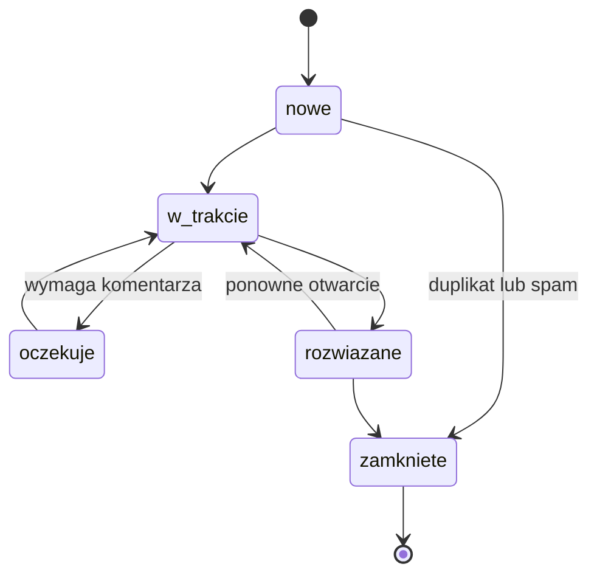

# helpdesk-ticket-api


REST API do obsługi zgłoszeń helpdesk: tworzenie zgłoszeń, obieg statusów, komentarze, historia zmian i terminy SLA. Projekt uzupełnia case study [obieg-dokumentow-wdrozenie](https://github.com/xg0m/obieg-dokumentow-wdrozenie) o warstwę integracji: pokazuje, jak system wystawia API, z którego mogą korzystać inne aplikacje uczelni. Dane są fikcyjne.

## Funkcje

- Zgłoszenia z kategorią (sprzet, oprogramowanie, dostep, siec, inne) i priorytetem (krytyczny, wysoki, sredni, niski).
- Obieg statusów z kontrolą dozwolonych przejść. Niedozwolone przejście zwraca kod 409.
- Termin SLA liczony z priorytetu oraz licznik zgłoszeń po terminie.
- Komentarze i pełna historia zmian statusu.
- Autoryzacja kluczem API w nagłówku `X-API-Key`, porównywanym w stałym czasie (`secrets.compare_digest`).
- Walidacja danych wejściowych (Pydantic) i zapytania SQL z parametrami.

## Obieg statusów



## SLA

| Priorytet | Czas na rozwiązanie |
|---|---|
| krytyczny | 4 h |
| wysoki | 8 h |
| sredni | 24 h |
| niski | 72 h |

Zgłoszenie jest po terminie, gdy ma status nowe, w_trakcie lub oczekuje, a termin SLA już minął.

## Endpointy

| Metoda | Ścieżka | Opis |
|---|---|---|
| GET | `/health` | Stan usługi (bez klucza API) |
| POST | `/tickets` | Nowe zgłoszenie |
| GET | `/tickets?status=&priority=` | Lista zgłoszeń z filtrami |
| GET | `/tickets/{id}` | Szczegóły zgłoszenia |
| PATCH | `/tickets/{id}/status` | Zmiana statusu (opcjonalnie z komentarzem) |
| POST | `/tickets/{id}/comments` | Nowy komentarz |
| GET | `/tickets/{id}/comments` | Komentarze zgłoszenia |
| GET | `/tickets/{id}/history` | Historia zmian statusu |
| GET | `/stats` | Liczba zgłoszeń wg statusu i liczba po terminie SLA |

## Uruchomienie

```bash
git clone https://github.com/xg0m/helpdesk-ticket-api.git
cd helpdesk-ticket-api
python -m venv venv
# Linux i macOS: source venv/bin/activate
# Windows (PowerShell): venv/Scripts/Activate.ps1
pip install -r requirements.txt

# Klucz API ustawiasz w zmiennej środowiskowej, nigdy w kodzie.
# Linux i macOS: export HELPDESK_API_KEY=twoj-klucz
# Windows (PowerShell): $env:HELPDESK_API_KEY = "twoj-klucz"
uvicorn app.main:create_app --factory --reload
```

Interaktywna dokumentacja (Swagger UI): http://127.0.0.1:8000/docs

Przykładowe zgłoszenie z pliku `examples/zgloszenie.json`:

```bash
curl -X POST http://127.0.0.1:8000/tickets -H "X-API-Key: twoj-klucz" -H "Content-Type: application/json" -d @examples/zgloszenie.json
```

## Testy

```bash
pytest -v
```

Testy używają tymczasowej bazy i sterowanego zegara, więc sprawdzają terminy SLA bez czekania. Obejmują autoryzację, walidację danych, wszystkie przejścia statusów, komentarze, filtry, statystyki i odporność na SQL injection. GitHub Actions uruchamia je przy każdym pushu.

## Decyzje i ograniczenia

- SQLite i osobne połączenie na każde żądanie wystarczają do demonstracji. Wdrożenie produkcyjne wymagałoby np. PostgreSQL i migracji schematu.
- Jeden klucz API zamiast kont użytkowników. W prawdziwym wdrożeniu logowanie przez SSO (OpenID Connect) i role.
- Gdy klucz API nie jest ustawiony, API odpowiada kodem 503, zamiast działać bez zabezpieczeń.
- Brak powiadomień e-mail i kolejek zadań.

## Praca z narzędziami AI

Kod powstawał z pomocą narzędzi AI. Weryfikuję go testami i czytam przed zatwierdzeniem. Reguły pracy opisuje [AGENTS.md](AGENTS.md).

## Autor

Oliwier Sieniuc, [@xg0m](https://github.com/xg0m). Licencja MIT.
